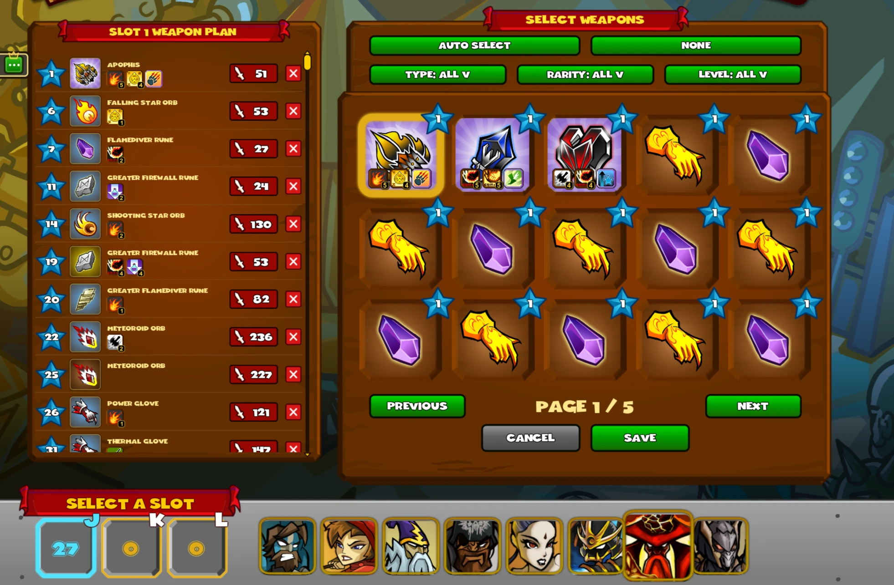
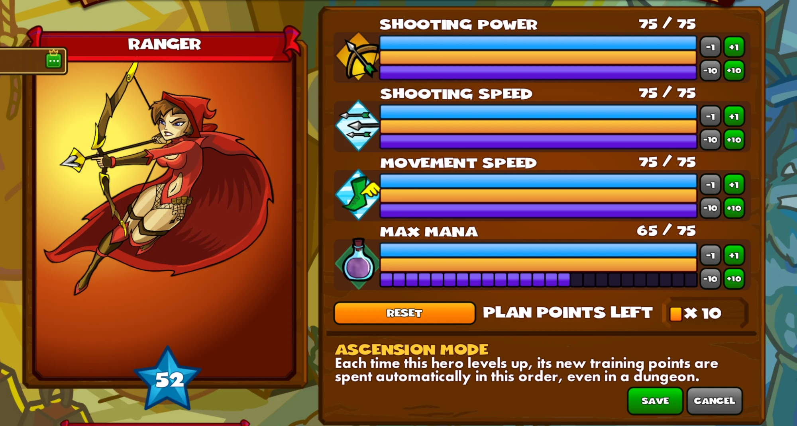
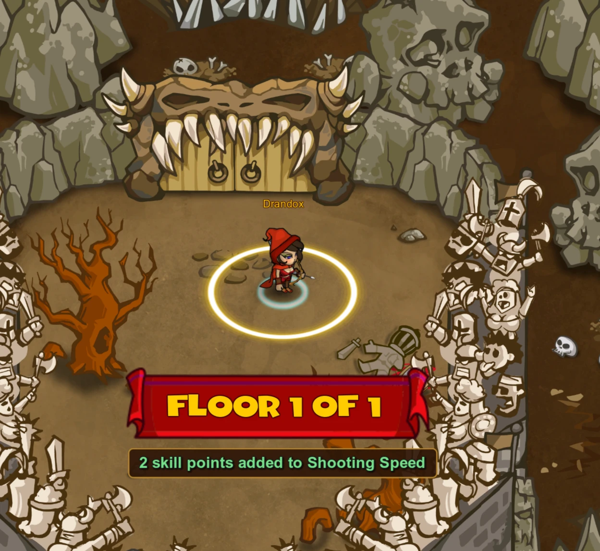

# Ascension Helper

Plan each hero's weapons and training once; the mod equips the weapons and spends the training points by your plan as the hero levels up, including while you ascend.

<!-- drh:show -->
Plan each hero's weapons and training once. As the hero levels up, the mod equips the planned weapons and spends new training points by your plan, in Town or in a dungeon.

- **Weapon plan:** open Storage > Loot, select an owned hero and press **ASCENSION** beside Add Storage. Pick a slot (J, K or L) and choose one weapon for each required level. Filter by type, rarity and level; **Auto Select** fills the slot from the filtered list, preferring rarity, mana and estimated combat value. **None** clears the slot's plan. **Save** keeps it, **Cancel** discards your changes, and switching hero or closing Storage saves too.
- **Automatic equipment:** after a confirmed level-up, the latest planned weapon at or below the hero's level is equipped with the game's normal equip request, one at a time. Manual changes at the same level are kept, missing weapons are reported, and nothing is equipped until a plan exists.
- **Training plan:** open Training and press **ASCENSION**. Each stat row gets **-1 +1 -10 +10**: the plan is an ordered list of up to 300 points (75 per stat). Adding goes to the end of the list; removing takes that stat's last points, so the order is kept. **RESET** empties the plan, **SAVE** keeps it, **CANCEL** discards it, and switching hero saves.
- **Automatic training:** whenever a hero has unspent training points, they are spent in plan order with the game's own training request, even in a dungeon right after a level-up. Points you already spent count toward the plan, and stats are never lowered. A message such as "3 skill points added to Melee Power" confirms each spend; if a loading screen hides it, it is shown again after loading.
- **Inventory extras:** modifier icons show their star level, the selected slot is marked in cyan, and the planner works with a controller (D-pad to move, A to press or toggle a weapon).

**Settings > Mods:** **Automatic equipment** and **Automatic training** (both on by default) turn the automatic parts off while keeping your plans.

**Not compatible with Weapon Modifiers in Inventory Preview:** both mods draw weapon levels and modifier icons on the same inventory cards. Ascension Helper uses its own display for these, so enable only one of the two.

Plans are stored only in this mod's local data folder, per account and hero. Nothing is uploaded. Game artwork and fonts are loaded from the installed game and are not included.
<!-- /drh:show -->

## Screenshots

Weapon plan for one slot, with filters and the selected-slot counts:

Training plan on the Training screen:

Training points spent automatically at the start of a dungeon:

## Notes

- Requires DRH 18 and API 1.5 (`extends`). Restart the game after installing.
- Equipment and training requests can be sent during a dungeon. The account is updated at once; whether the current run uses the change right away is decided by the game server.
- Auto Select scores are a selection aid, not measured DPS. Manual choices always win.
- The mod never sells items, opens chests, buys storage, moves weapons off another hero or lowers stats.

## Development

Run `python tests/run.py --haxe PATH_TO_HAXE` for the offline tests. They use test doubles for the game and do not run the native game.

## Credits

Thanks to [XξИӦĜεй三尺Šĭ乌](https://github.com/Xenogenersis/) for the idea.

## License

Code is GPL-3.0; see [LICENSE](LICENSE).
